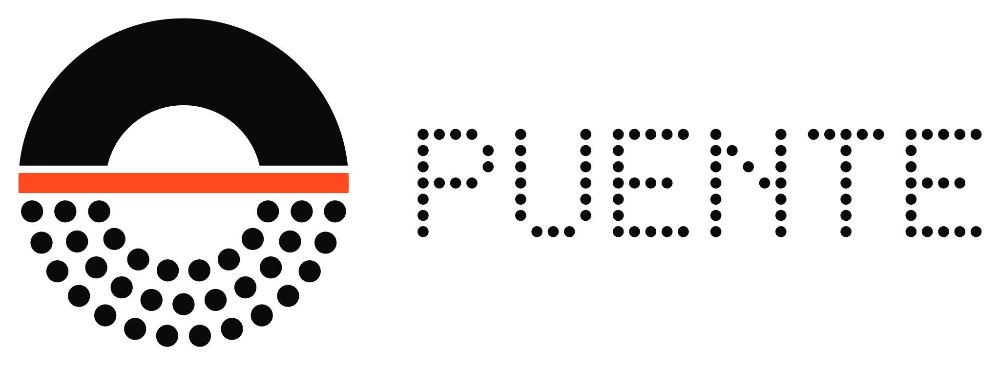
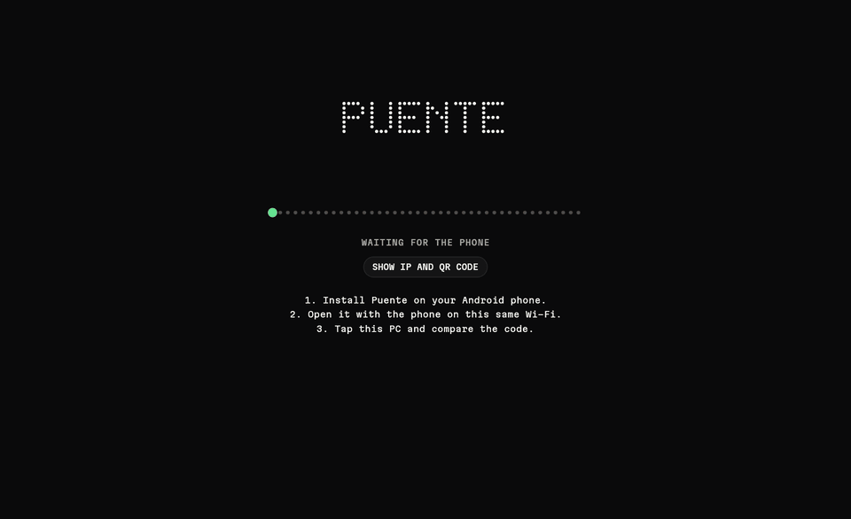
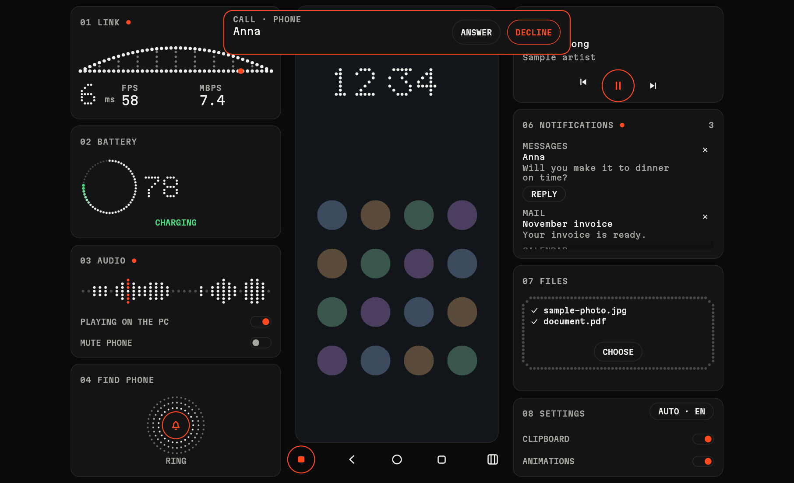
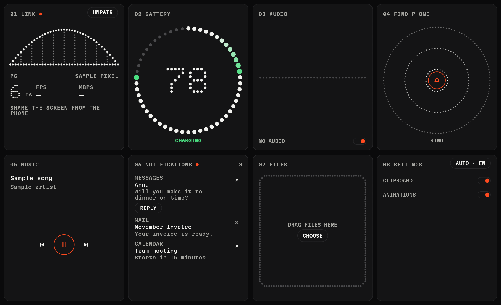
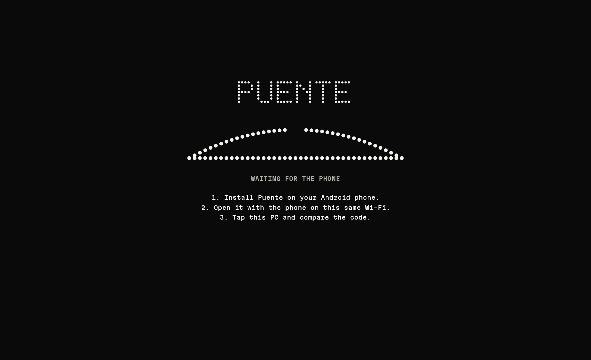
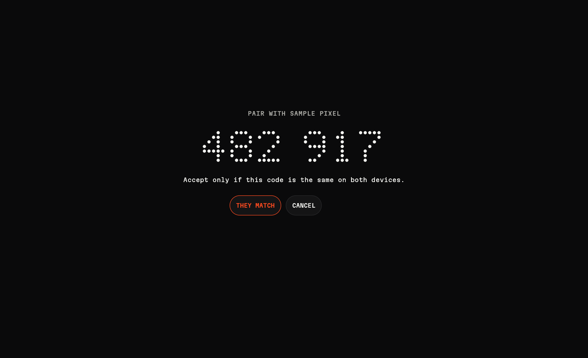
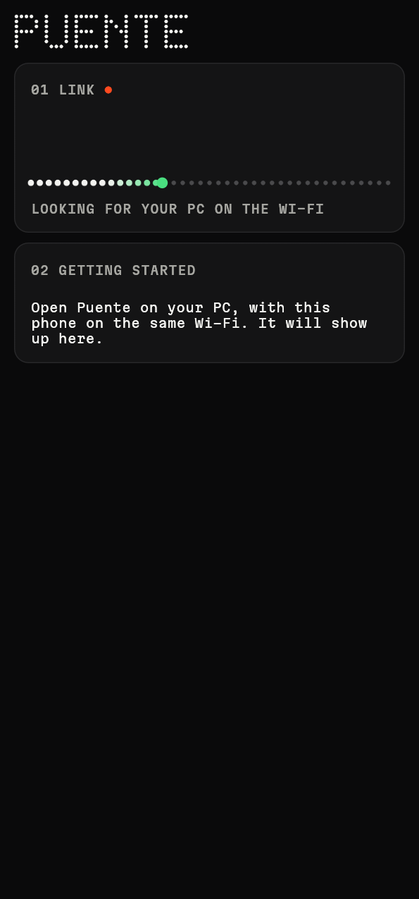
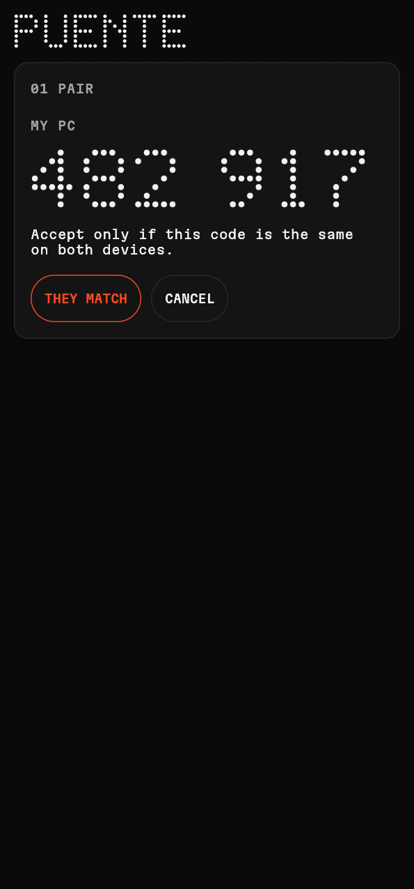
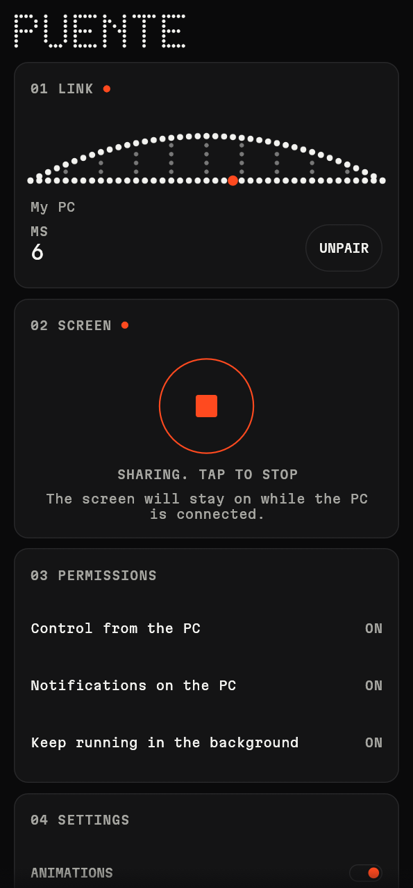
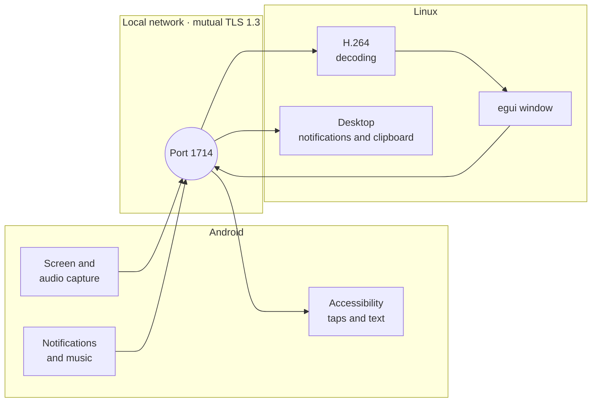

<div align="center">

<picture>
  <source media="(prefers-color-scheme: dark)" srcset="branding/puente-lockup.svg">
  
</picture>

**Your Android phone, inside your Linux PC.**<br>
See it, control it and get everything from it. No cable, no ADB and no developer mode.

[](LICENSE)


[Español](README.md) · **English** · [Português](README.pt.md)



<sub>Screenshots and GIF made with sample data.</sub>

</div>

## Why it exists

On Linux, keeping your phone at hand usually takes two tools: **KDE Connect** for notifications and files, and **scrcpy** to see and control the screen, the latter with a cable or debugging turned on. Puente brings them together in **one app and one pairing**, using only what Android offers to any app.

## Screenshots

<table>
  <tr>
    <td width="50%"></td>
    <td width="50%"></td>
  </tr>
  <tr>
    <td align="center"><b>Streaming.</b> The phone in the middle and its instruments around it.</td>
    <td align="center"><b>Not streaming.</b> The cards fill the whole window.</td>
  </tr>
  <tr>
    <td></td>
    <td></td>
  </tr>
  <tr>
    <td align="center"><b>Searching.</b> The bridge builds itself while the phone arrives.</td>
    <td align="center"><b>Pairing.</b> A code you compare on both devices.</td>
  </tr>
</table>

<p align="center">
  
  
  
</p>

## What you can do

| | Feature | Details |
|---|---|---|
| **Screen** | See and control the phone | Mouse, wheel and keyboard; back, home and recents; follows the phone when it rotates |
| **Sound** | Hear the phone on the PC | With a switch to turn it off, and another to mute the phone while streaming |
| **Notifications** | On your desktop | Dismiss them and, if the app allows it, reply from the PC |
| **Calls** | See who is calling | Alert on the PC, also for calls from other apps. Answering from the PC does not work with WhatsApp yet |
| **Files** | Send both ways | By dragging onto the window, with progress and confirmation that they were saved |
| **Clipboard** | Copy and paste between devices | Automatic from the PC to the phone |
| **Music** | Control what is playing | Play, pause, previous and next |
| **Battery** | Level and charging | Animated ring of dots while charging |
| **Find** | Make the phone ring | Rings like an alarm for 30 seconds |
| **Languages** | Spanish, English and Portuguese | Follows the system language or the one you pick in Settings |

The phone screen stays on while you share it with a connected PC, and you can stop the stream from either side. Press `F2` or the button in the bar to hide the cards and keep only the stream.

On Linux you can also send files from the terminal to the open window:

```bash
puente --send photo.jpg document.pdf
```

## How it works



Everything is written in **Rust** with [egui](https://github.com/emilk/egui), built for the desktop and for Android from the same code. There is only a thin Kotlin layer for the classes Android requires, such as the capture and Accessibility services.

## Download

Get the latest version from [Releases](https://github.com/jorge07RD/puente/releases/latest):

| Platform | File | How to install |
|---|---|---|
| **Android** | `puente-*-android-arm64.apk` | Open it on the phone. Play Protect will warn you because it is installed by hand |
| **Linux** | `puente-*-linux-x86_64.tar.gz` | Extract it and run `./install.sh` |
| **Windows** (experimental) | `puente-*-windows-x86_64.zip` | Extract it and open `puente.exe`; allow access in the firewall |

The Windows version builds and passes the automated tests, but it has not been tried with a real phone yet.

## Requirements

| | You need |
|---|---|
| **PC** | Linux. Tested on Hyprland with XWayland |
| **Phone** | Android 10 or newer, arm64. Tested on a Samsung Galaxy S23 Ultra |
| **Network** | Both on the same local network, with port 1714 TCP and UDP open on the PC |

If you use `ufw`:

```bash
sudo ufw allow 1714/tcp
sudo ufw allow 1714/udp
```

## Build from source

Dependencies on Arch Linux:

```bash
sudo pacman -S --needed rust nasm cmake clang alsa-lib jdk17-openjdk
```

**On the PC.** Builds, installs to `~/.local/bin` and adds the entry to the app menu:

```bash
./scripts/install-desktop.sh
```

**For the phone.** You need the Android SDK with platform 35, NDK r29 and a Rust with the Android target, installed with [rustup](https://rustup.rs):

```bash
rustup target add aarch64-linux-android
cargo install cargo-ndk
./scripts/build-android.sh
```

The APK ends up in `android/app/build/outputs/apk/debug/app-debug.apk`.

## First use

1. Open Puente on the PC and on the phone, on the same network.
2. Tap your PC on the phone and check that the 6-digit code matches on both.
3. Tap **Share screen**. Android will ask you to confirm every time.
4. Turn on **Control from the PC** and **Notifications on the PC**.

> [!NOTE]
> Because the app is installed by hand, Android marks those permissions as restricted and Play Protect may warn you when installing it. If a permission is blocked, go to Settings, Apps, Puente, top menu, **Allow restricted settings**.

## Limits

Working without ADB has a price, because Android imposes these restrictions:

- You have to confirm every time you start sharing the screen.
- Protected apps, such as banking apps, show up black.
- The clipboard from the phone to the PC is not automatic: Android does not allow reading it in the background. It is sent when you open Puente or with Share, **Send to PC**.
- Typing from the PC uses Accessibility and may fail in games or apps with their own interface.

To allow dragging files, the desktop app uses XWayland. On screens with fractional scaling it may look blurry; `PUENTE_BACKEND=wayland` avoids that, at the cost of not being able to drag.

It is a young project, tested so far on a single phone model. Reports from other devices are welcome.

## Security

- Connections use **mutual TLS 1.3**, with certificates pinned when pairing.
- The 6-digit code includes a prior commitment, so an attacker on the network cannot force it to match.
- The phone only obeys a paired PC, and only while it is sharing its screen.
- Unpairing removes the pairing on both devices.

If you find a security problem, open an issue without exploitable details.

## Layout

```text
crates/
  puente-core/      protocol, network, security and transfers
  puente-ui/        shared screens, translations and the visual language of dots
  puente-desktop/   Linux binary: video, audio and desktop integration
  puente-android/   JNI bridge to Android
android/            Gradle project and the Kotlin layer
branding/           logo and icons
```

The visual system is documented in [`DESIGN.md`](DESIGN.md) (in Spanish). The images in this README are regenerated with `./scripts/make-readme-media.sh`, and `puente --gallery` shows every piece of the interface.

## License

[GPL-3.0](LICENSE). The Martian Mono font is distributed under [SIL OFL 1.1](crates/puente-ui/assets/fonts/OFL.txt).
