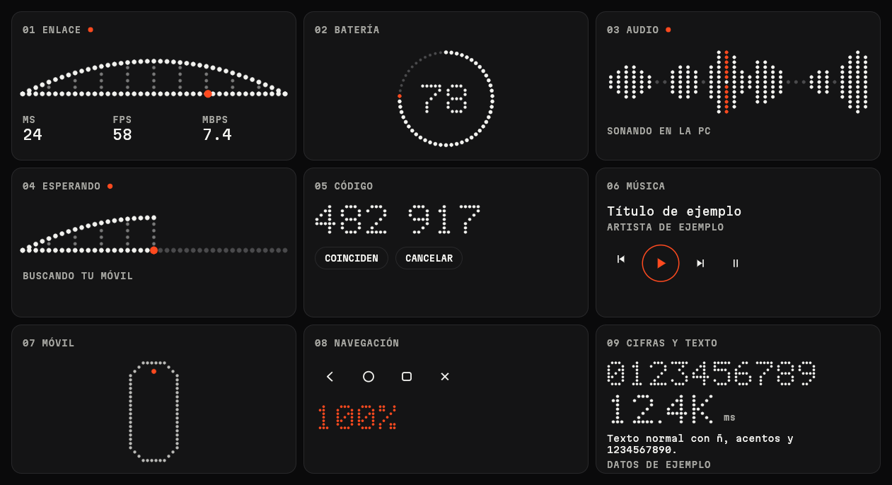

# Puente

Ve y controla tu móvil Android desde tu PC con Linux, sin cable, sin ADB y sin modo desarrollador. Reúne en una sola app lo que hacen por separado KDE Connect y scrcpy.



## Qué hace

- Muestra la pantalla del móvil y te deja manejarla con ratón y teclado.
- Trae a la PC las notificaciones, la batería y los controles de música.
- Comparte el portapapeles y envía archivos en los dos sentidos, también arrastrándolos a la ventana.
- Reproduce en la PC el audio del móvil.
- Hace sonar el móvil cuando no lo encuentras.

Un solo código en Rust y [egui](https://github.com/emilk/egui) para escritorio y Android, con una capa mínima en Kotlin para las clases que Android exige.

## Requisitos

| Lado | Necesitas |
|---|---|
| PC | Linux; probado en Hyprland con XWayland |
| Móvil | Android 10 o superior, arm64; probado en un Samsung Galaxy S23 Ultra |
| Red | Los dos en la misma red local, con el puerto 1714 TCP y UDP abierto en la PC |

Con `ufw`:

```bash
sudo ufw allow 1714/tcp
sudo ufw allow 1714/udp
```

## Compilar

Dependencias en Arch Linux:

```bash
sudo pacman -S --needed rust nasm cmake clang alsa-lib jdk17-openjdk
```

**PC.** Compila, instala en `~/.local/bin` y añade la entrada al menú de aplicaciones:

```bash
./scripts/install-desktop.sh
```

**Móvil.** Necesitas el SDK de Android con la plataforma 35, el NDK r29, `cargo-ndk` y un Rust con el target de Android (instalado con [rustup](https://rustup.rs)):

```bash
rustup target add aarch64-linux-android
cargo install cargo-ndk
./scripts/build-android.sh
```

El APK queda en `android/app/build/outputs/apk/debug/app-debug.apk`.

## Primer uso

1. Abre Puente en la PC y en el móvil, en la misma red.
2. Toca tu PC en el móvil y confirma que el código de 6 dígitos coincide en los dos.
3. Toca **Compartir pantalla**. Android lo pedirá confirmar cada vez.
4. Activa **Control desde la PC** y **Avisos en la PC**.

> Al ser una app instalada a mano, Android marca esos permisos como restringidos. Si lo bloquea, ve a Ajustes, Aplicaciones, Puente, menú superior, **Permitir ajustes restringidos**.

En la PC, el botón de la barra o `F2` oculta las tarjetas para dejar solo la transmisión.

## Límites

Funcionar sin ADB tiene un precio, porque estas restricciones las impone Android:

- Hay que confirmar cada vez que se empieza a compartir la pantalla.
- Las apps protegidas, como las de bancos, se ven en negro.
- El portapapeles del móvil a la PC no es automático: Android impide leerlo en segundo plano. Se envía al abrir Puente o con Compartir, **Enviar a la PC**.
- Escribir desde la PC usa Accesibilidad y puede fallar en juegos o apps con interfaz propia.

Para poder arrastrar archivos, la app de escritorio usa XWayland. En pantallas con escalado fraccional puede verse borrosa; `PUENTE_BACKEND=wayland` lo evita, a cambio de no poder arrastrar.

## Seguridad

Las conexiones usan TLS 1.3 mutuo con certificados fijados al emparejar. El código de 6 dígitos incluye un compromiso previo para que un atacante en la red no pueda forzar que coincida. El móvil solo obedece órdenes de una PC emparejada y mientras comparte su pantalla.

Si encuentras un problema de seguridad, abre un issue sin incluir detalles explotables.

## Licencia

[GPL-3.0](LICENSE). La fuente Martian Mono se distribuye bajo [SIL OFL 1.1](crates/puente-ui/assets/fonts/OFL.txt).
