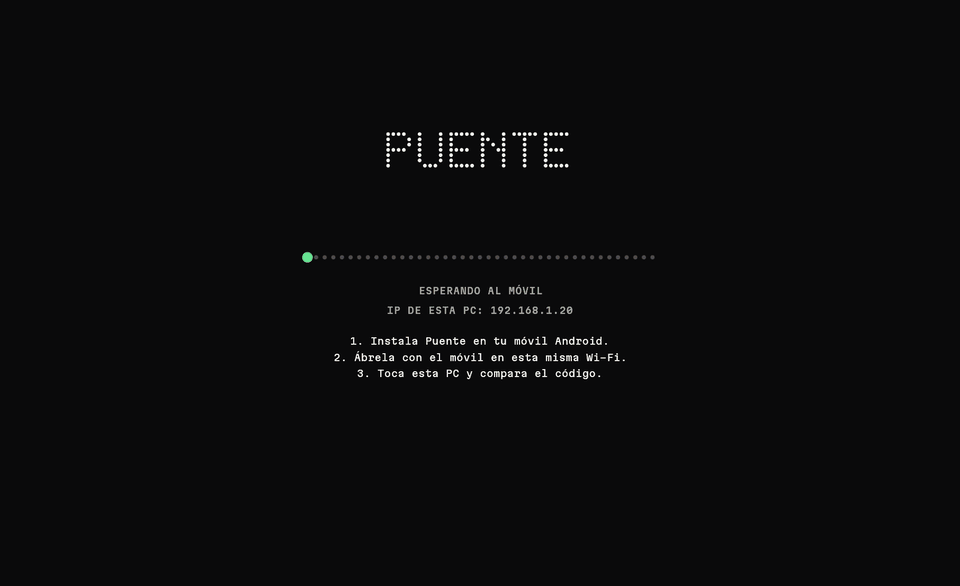
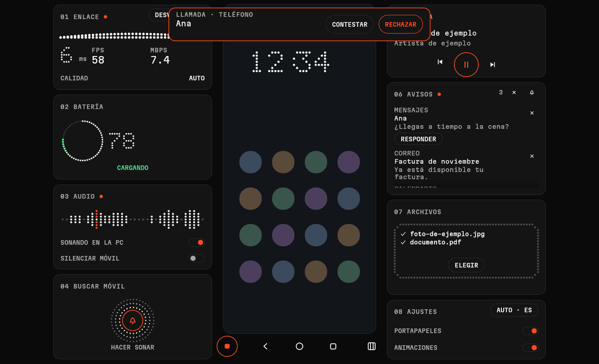
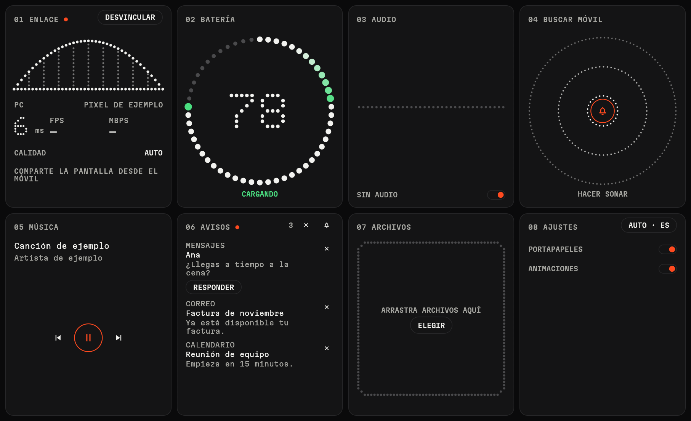
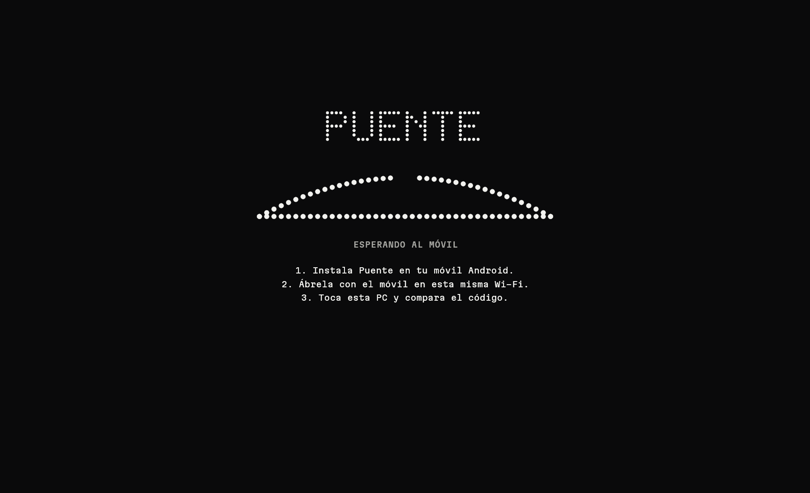
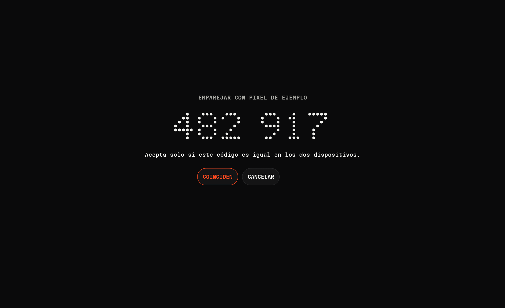
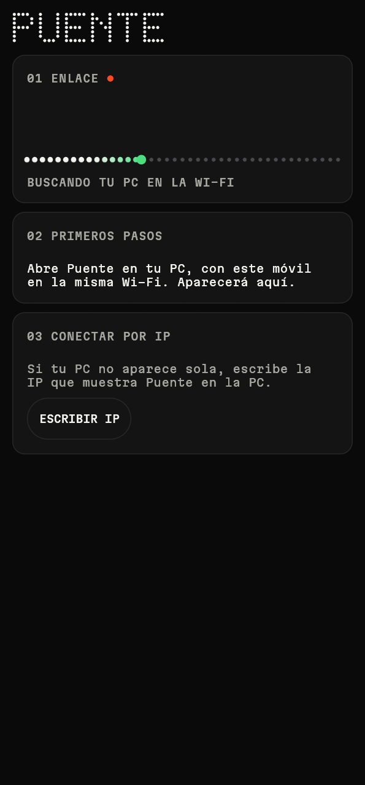
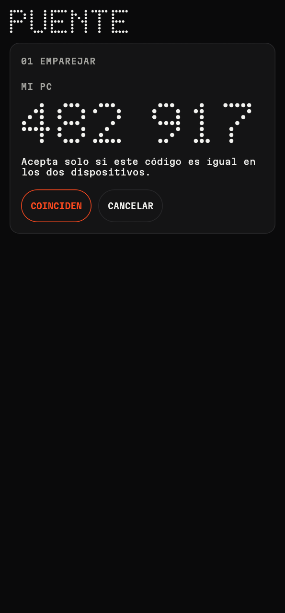
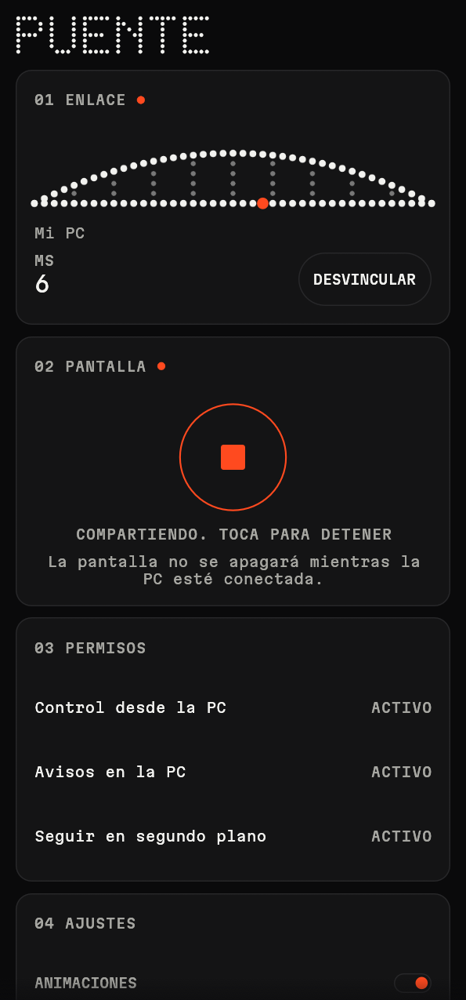
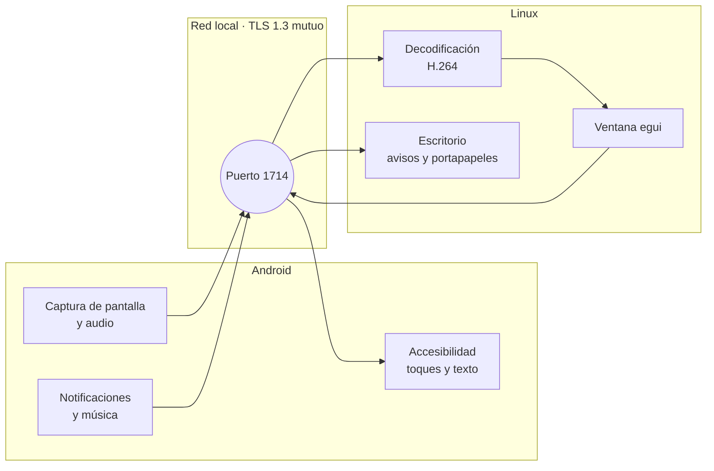

<div align="center">

<picture>
  <source media="(prefers-color-scheme: dark)" srcset="branding/puente-lockup.svg">
  
</picture>

**Tu móvil Android, dentro de tu PC con Linux.**<br>
Míralo, contrólalo y recibe todo lo suyo. Sin cable, sin ADB y sin modo desarrollador.

[](LICENSE)


**Español** · [English](README.en.md) · [Português](README.pt.md)



<sub>Capturas y GIF generados con datos de ejemplo.</sub>

</div>

## Por qué existe

En Linux, tener el móvil a mano suele exigir dos herramientas: **KDE Connect** para notificaciones y archivos, y **scrcpy** para ver y controlar la pantalla, esta última con cable o depuración activada. Puente las reúne en **una sola app y un solo emparejamiento**, usando únicamente lo que Android ofrece a cualquier aplicación.

## Capturas

<table>
  <tr>
    <td width="50%"></td>
    <td width="50%"></td>
  </tr>
  <tr>
    <td align="center"><b>Transmitiendo.</b> El móvil en el centro y sus instrumentos alrededor.</td>
    <td align="center"><b>Sin transmisión.</b> Las tarjetas ocupan toda la ventana.</td>
  </tr>
  <tr>
    <td></td>
    <td></td>
  </tr>
  <tr>
    <td align="center"><b>Buscando.</b> El puente se construye mientras llega el móvil.</td>
    <td align="center"><b>Emparejar.</b> Un código que se compara en los dos dispositivos.</td>
  </tr>
</table>

<p align="center">
  
  
  
</p>

## Qué puedes hacer

| | Función | Detalle |
|---|---|---|
| **Pantalla** | Ver y controlar el móvil | Ratón, rueda y teclado; atrás, inicio y recientes; se adapta al girar el móvil |
| **Sonido** | Oír el móvil en la PC | Con interruptor para desactivarlo, y otro para silenciar el móvil mientras transmites |
| **Avisos** | Notificaciones en el escritorio | Se pueden descartar y, si la app lo admite, responder desde la PC |
| **Llamadas** | Ver quién llama | Aviso en la PC, también para llamadas de otras apps. Contestar desde la PC todavía no funciona en WhatsApp |
| **Archivos** | Enviar en los dos sentidos | Arrastrando a la ventana, con progreso y confirmación de que se guardaron |
| **Portapapeles** | Copiar y pegar entre dispositivos | Automático de la PC al móvil |
| **Música** | Controlar lo que suena | Reproducir, pausar, anterior y siguiente |
| **Batería** | Nivel y carga | Anillo de puntos animado mientras carga |
| **Buscar** | Hacer sonar el móvil | Suena como alarma durante 30 segundos |
| **Idiomas** | Español, inglés y portugués | Sigue el idioma del sistema o el que elijas en Ajustes |

Mientras compartes la pantalla con una PC conectada, el móvil no se apaga ni se bloquea (necesita **Control desde la PC** activado), y puedes cortar la transmisión desde cualquiera de los dos lados. Con `F2` o el botón de la barra ocultas las tarjetas para dejar solo la transmisión.

En Linux también puedes enviar archivos desde la terminal a la ventana abierta:

```bash
puente --send foto.jpg documento.pdf
```

## Cómo funciona



Todo está escrito en **Rust** con [egui](https://github.com/emilk/egui), compilado para escritorio y para Android desde el mismo código. Solo hay una capa fina en Kotlin para las clases que Android exige, como los servicios de captura y Accesibilidad.

## Descargar

Descarga la última versión desde [Releases](https://github.com/jorge07RD/puente/releases/latest):

| Plataforma | Archivo | Cómo instalar |
|---|---|---|
| **Android** | `puente-*-android-arm64.apk` | Ábrelo en el móvil. Play Protect avisará por ser una app instalada a mano |
| **Linux** | `puente-*-linux-x86_64.tar.gz` | Descomprime y ejecuta `./install.sh` |
| **Windows** (experimental) | `puente-*-windows-x86_64.zip` | Descomprime y abre `puente.exe`; permite el acceso en el firewall |

La versión de Windows compila y pasa las pruebas automáticas, pero aún no se ha probado con un móvil real.

## Requisitos

| | Necesitas |
|---|---|
| **PC** | Linux. Probado en Hyprland con XWayland |
| **Móvil** | Android 10 o superior, arm64. Probado en un Samsung Galaxy S23 Ultra |
| **Red** | Los dos en la misma red local, con el puerto 1714 TCP y UDP abierto en la PC |

Si usas `ufw`:

```bash
sudo ufw allow 1714/tcp
sudo ufw allow 1714/udp
```

## Compilar desde el código

Dependencias en Arch Linux:

```bash
sudo pacman -S --needed rust nasm cmake clang alsa-lib jdk17-openjdk
```

**En la PC.** Compila, instala en `~/.local/bin` y añade la entrada al menú de aplicaciones:

```bash
./scripts/install-desktop.sh
```

**Para el móvil.** Necesitas el SDK de Android con la plataforma 35, el NDK r29 y un Rust con el target de Android, instalado con [rustup](https://rustup.rs):

```bash
rustup target add aarch64-linux-android
cargo install cargo-ndk
./scripts/build-android.sh
```

El APK queda en `android/app/build/outputs/apk/debug/app-debug.apk`.

## Primer uso

1. Abre Puente en la PC y en el móvil, en la misma red.
2. Toca tu PC en el móvil y confirma que el código de 6 dígitos coincide en los dos.
3. Toca **Compartir pantalla**. Android te pedirá confirmarlo cada vez.
4. Activa **Control desde la PC** y **Avisos en la PC**.

> [!NOTE]
> Al ser una app instalada a mano, Android marca esos permisos como restringidos y Play Protect puede avisar al instalarla. Si bloquea un permiso, ve a Ajustes, Aplicaciones, Puente, menú superior, **Permitir ajustes restringidos**.

## Límites

Funcionar sin ADB tiene un precio, porque estas restricciones las impone Android:

- Hay que confirmar cada vez que se empieza a compartir la pantalla.
- Las apps protegidas, como las de bancos, se ven en negro.
- **Silenciar móvil** depende de que Android siga capturando el audio con la música en silencio. Si en tu móvil también se calla la PC, déjalo apagado.
- El portapapeles del móvil a la PC no es automático: Android impide leerlo en segundo plano. Se envía al abrir Puente o con Compartir, **Enviar a la PC**.
- Escribir desde la PC usa Accesibilidad y puede fallar en juegos o apps con interfaz propia.

Para poder arrastrar archivos, la app de escritorio usa XWayland. En pantallas con escalado fraccional puede verse borrosa; `PUENTE_BACKEND=wayland` lo evita, a cambio de no poder arrastrar.

Es un proyecto joven, probado por ahora en un solo modelo de móvil. Los informes de otros dispositivos son bienvenidos.

## Seguridad

- Las conexiones usan **TLS 1.3 mutuo**, con certificados fijados al emparejar.
- El código de 6 dígitos incluye un compromiso previo, para que un atacante en la red no pueda forzar que coincida.
- El móvil solo obedece a una PC emparejada, y solo mientras comparte su pantalla.
- Desvincular borra el emparejamiento en los dos dispositivos.

Si encuentras un problema de seguridad, abre un issue sin incluir detalles explotables.

## Estructura

```text
crates/
  puente-core/      protocolo, red, seguridad y transferencias
  puente-ui/        pantallas compartidas, traducciones y el lenguaje visual de puntos
  puente-desktop/   binario de Linux: vídeo, audio e integración con el escritorio
  puente-android/   puente JNI hacia Android
android/            proyecto Gradle y la capa Kotlin
branding/           logotipo e iconos
```

El sistema visual está documentado en [`DESIGN.md`](DESIGN.md). Las imágenes de este README se regeneran con `./scripts/make-readme-media.sh`, y `puente --gallery` muestra todas las piezas de la interfaz.

## Licencia

[GPL-3.0](LICENSE). La fuente Martian Mono se distribuye bajo [SIL OFL 1.1](crates/puente-ui/assets/fonts/OFL.txt).
