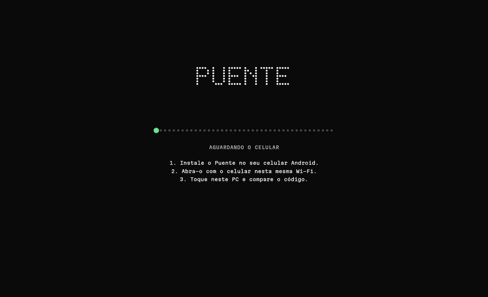
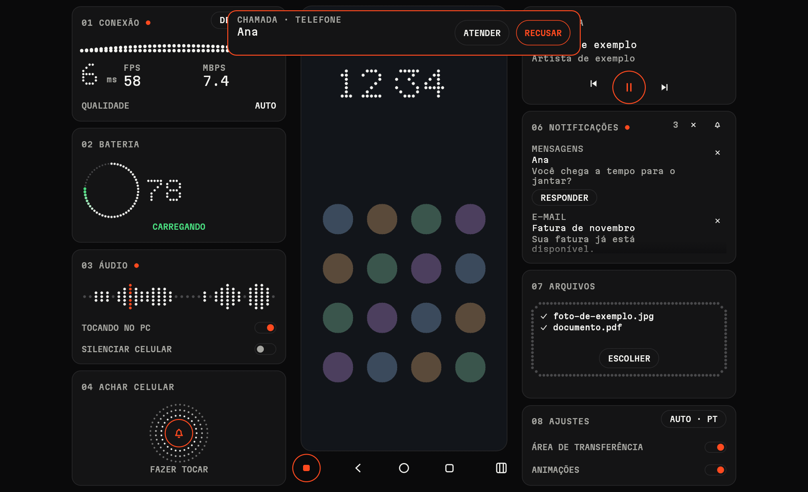
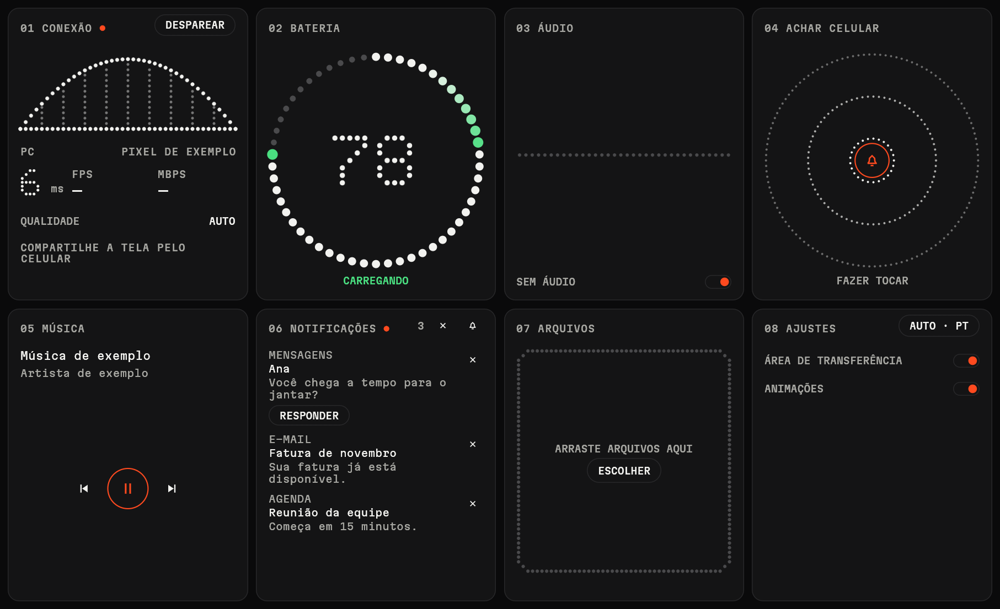
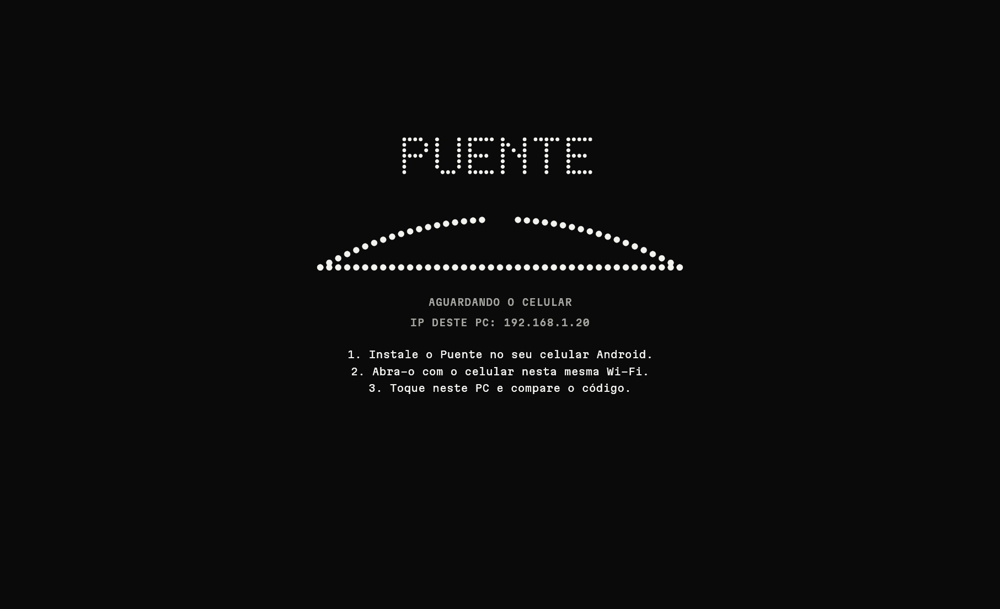
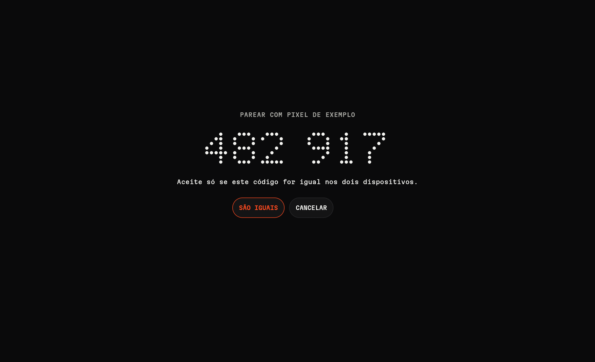
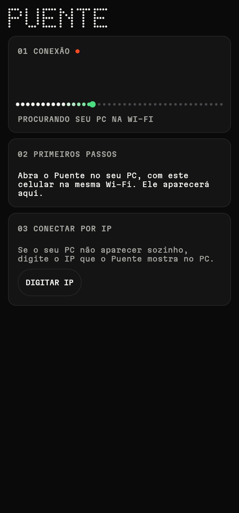
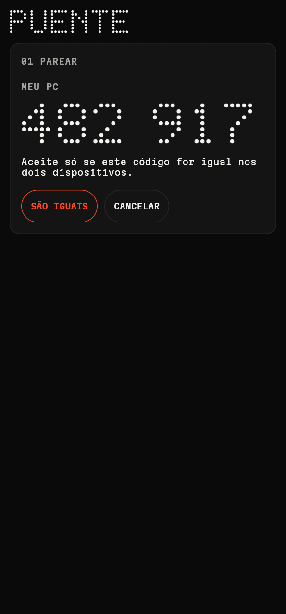
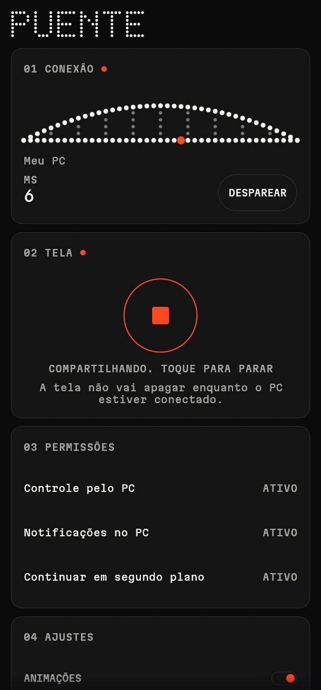
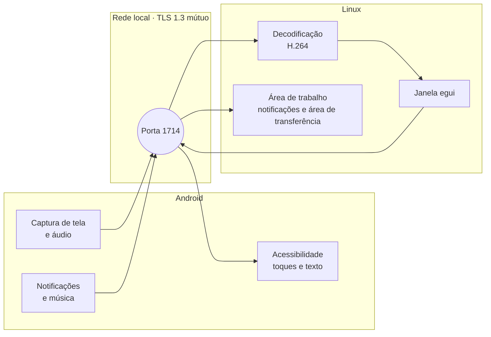

<div align="center">

<picture>
  <source media="(prefers-color-scheme: dark)" srcset="branding/puente-lockup.svg">
  
</picture>

**Seu celular Android, dentro do seu PC com Linux.**<br>
Veja, controle e receba tudo dele. Sem cabo, sem ADB e sem modo desenvolvedor.

[](LICENSE)


[Español](README.md) · [English](README.en.md) · **Português**



<sub>Capturas e GIF feitos com dados de exemplo.</sub>

</div>

## Por que existe

No Linux, ter o celular à mão costuma exigir duas ferramentas: o **KDE Connect** para notificações e arquivos, e o **scrcpy** para ver e controlar a tela, este último com cabo ou depuração ativada. O Puente junta os dois em **um só app e um só pareamento**, usando apenas o que o Android oferece a qualquer aplicativo.

## Capturas

<table>
  <tr>
    <td width="50%"></td>
    <td width="50%"></td>
  </tr>
  <tr>
    <td align="center"><b>Transmitindo.</b> O celular no centro e seus instrumentos ao redor.</td>
    <td align="center"><b>Sem transmissão.</b> Os cartões ocupam a janela inteira.</td>
  </tr>
  <tr>
    <td></td>
    <td></td>
  </tr>
  <tr>
    <td align="center"><b>Procurando.</b> A ponte se constrói enquanto o celular chega.</td>
    <td align="center"><b>Parear.</b> Um código que se compara nos dois dispositivos.</td>
  </tr>
</table>

<p align="center">
  
  
  
</p>

## O que você pode fazer

| | Função | Detalhe |
|---|---|---|
| **Tela** | Ver e controlar o celular | Mouse, roda e teclado; voltar, início e recentes, também com clique direito, clique do meio e os botões laterais; acompanha o celular quando ele gira |
| **Qualidade** | Automática ou fixa | Auto ajusta os dados ao que a rede aguenta sem cortar a imagem; também Economia, Normal e Alta |
| **Som** | Ouvir o celular no PC | Com um botão para desativar, e outro para silenciar o celular durante a transmissão |
| **Notificações** | Na área de trabalho | Dá para dispensá-las uma a uma ou todas de uma vez e, se o app permitir, responder pelo PC. O sino escolhe se aparecem como notificação do PC, só na lista ou desligadas |
| **Chamadas** | Ver quem está ligando | Aviso no PC, também para chamadas de outros apps. Atender pelo PC ainda não funciona no WhatsApp |
| **Arquivos** | Enviar nos dois sentidos | Arrastando para a janela, com progresso e confirmação de que foram salvos |
| **Área de transferência** | Copiar e colar entre dispositivos | Automática do PC para o celular |
| **Música** | Controlar o que está tocando | Tocar, pausar, anterior e próxima |
| **Bateria** | Nível e carga | Anel de pontos animado enquanto carrega |
| **Achar** | Fazer o celular tocar | Toca como alarme por 30 segundos |
| **Idiomas** | Espanhol, inglês e português | Segue o idioma do sistema ou o que você escolher em Ajustes |
| **Bandeja** | Sempre à mão | Ao fechar a janela, o Puente continua conectado na bandeja; pode iniciar sozinho com a sessão |

Enquanto você compartilha a tela com um PC conectado, o celular não apaga nem bloqueia (precisa de **Controle pelo PC** ativado), e dá para parar a transmissão de qualquer um dos lados. Com `F2` ou o botão da barra você oculta os cartões e deixa só a transmissão.

No Linux, fechar a janela deixa o Puente na bandeja do sistema, conectado ao celular. Pelo menu dele você pode abri-lo de novo, marcar **Iniciar com a sessão** ou sair. Se a sua barra não mostra ícones de bandeja, fechar a janela fecha o app como antes.

Você também pode enviar arquivos pelo terminal para a janela aberta:

```bash
puente --send foto.jpg documento.pdf
```

## Como funciona



Tudo é escrito em **Rust** com [egui](https://github.com/emilk/egui), compilado para desktop e para Android a partir do mesmo código. Há só uma camada fina em Kotlin para as classes que o Android exige, como os serviços de captura e de Acessibilidade.

## Baixar

Baixe a versão mais recente em [Releases](https://github.com/jorge07RD/puente/releases/latest):

| Plataforma | Arquivo | Como instalar |
|---|---|---|
| **Android** | `puente-*-android-arm64.apk` | Abra no celular. O Play Protect vai avisar por ser um app instalado manualmente |
| **Linux** | `puente-*-linux-x86_64.tar.gz` | Descompacte e execute `./install.sh` |
| **Windows** (experimental) | `puente-*-windows-x86_64.zip` | Descompacte e abra `puente.exe`; permita o acesso no firewall. Para deixá-lo à mão, clique com o botão direito em `puente.exe` e escolha «Criar atalho» |

A versão para Windows compila e passa nos testes automáticos, mas ainda não foi testada com um celular de verdade.

## Requisitos

| | Você precisa de |
|---|---|
| **PC** | Linux. Testado no Hyprland com XWayland |
| **Celular** | Android 10 ou superior, arm64. Testado em um Samsung Galaxy S23 Ultra |
| **Rede** | Os dois na mesma rede local, com a porta 1714 TCP e UDP aberta no PC. Se o PC não aparecer sozinho (Wi-Fi de convidados, VPN, outra sub-rede), toque em «Digitar IP» no celular e coloque o que o Puente mostra no PC |

Se você usa `ufw`:

```bash
sudo ufw allow 1714/tcp
sudo ufw allow 1714/udp
```

## Compilar a partir do código

Dependências no Arch Linux:

```bash
sudo pacman -S --needed rust nasm cmake clang alsa-lib jdk17-openjdk
```

**No PC.** Compila, instala em `~/.local/bin` e adiciona a entrada ao menu de aplicativos:

```bash
./scripts/install-desktop.sh
```

**Para o celular.** Você precisa do SDK do Android com a plataforma 35, do NDK r29 e de um Rust com o target do Android, instalado com [rustup](https://rustup.rs):

```bash
rustup target add aarch64-linux-android
cargo install cargo-ndk
./scripts/build-android.sh
```

O APK fica em `android/app/build/outputs/apk/debug/app-debug.apk`.

## Primeiro uso

1. Abra o Puente no PC e no celular, na mesma rede.
2. Toque no seu PC no celular e confirme que o código de 6 dígitos é igual nos dois.
3. Toque em **Compartilhar tela**. O Android vai pedir sua confirmação toda vez.
4. Ative **Controle pelo PC** e **Notificações no PC**.

> [!NOTE]
> Como o app é instalado manualmente, o Android marca essas permissões como restritas e o Play Protect pode avisar na instalação. Se uma permissão for bloqueada, vá em Configurações, Aplicativos, Puente, menu de cima, **Permitir configurações restritas**.

## Limites

Funcionar sem ADB tem um preço, porque o Android impõe estas restrições:

- É preciso confirmar toda vez que começar a compartilhar a tela.
- Apps protegidos, como os de bancos, aparecem pretos.
- **Silenciar celular** depende de o Android continuar capturando o áudio com a música em silêncio. Se no seu celular o PC também ficar mudo, deixe desligado.
- A área de transferência do celular para o PC não é automática: o Android impede lê-la em segundo plano. Ela é enviada ao abrir o Puente ou com Compartilhar, **Enviar ao PC**.
- Digitar pelo PC usa a Acessibilidade e pode falhar em jogos ou apps com interface própria.

Para poder arrastar arquivos, o app de desktop usa XWayland. Em telas com escala fracionada ele pode ficar borrado; `PUENTE_BACKEND=wayland` evita isso, mas aí não dá para arrastar.

É um projeto jovem, testado até agora em um só modelo de celular. Relatos de outros dispositivos são bem-vindos.

## Segurança

- As conexões usam **TLS 1.3 mútuo**, com certificados fixados no pareamento.
- O código de 6 dígitos inclui um compromisso prévio, para que um atacante na rede não consiga forçar que ele coincida.
- O celular só obedece a um PC pareado, e só enquanto compartilha a tela.
- Desparear apaga o pareamento nos dois dispositivos.

Se encontrar um problema de segurança, abra uma issue sem incluir detalhes exploráveis.

## Estrutura

```text
crates/
  puente-core/      protocolo, rede, segurança e transferências
  puente-ui/        telas compartilhadas, traduções e a linguagem visual de pontos
  puente-desktop/   binário do Linux: vídeo, áudio e integração com a área de trabalho
  puente-android/   ponte JNI para o Android
android/            projeto Gradle e a camada Kotlin
branding/           logotipo e ícones
```

O sistema visual está documentado em [`DESIGN.md`](DESIGN.md) (em espanhol). As imagens deste README são geradas de novo com `./scripts/make-readme-media.sh`, e `puente --gallery` mostra todas as peças da interface.

## Licença

[GPL-3.0](LICENSE). A fonte Martian Mono é distribuída sob a [SIL OFL 1.1](crates/puente-ui/assets/fonts/OFL.txt).
